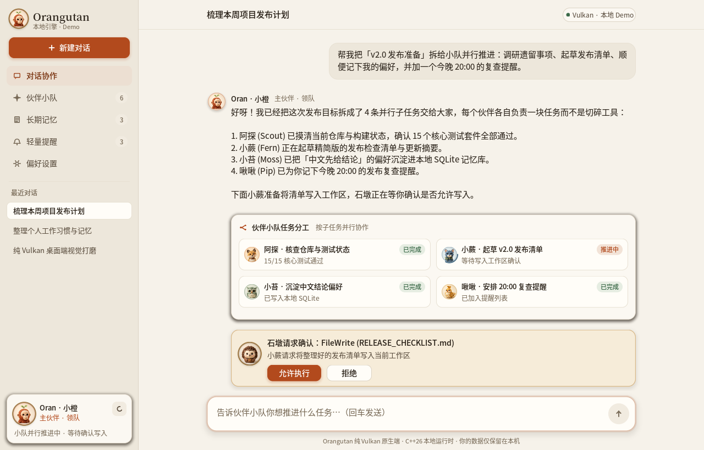
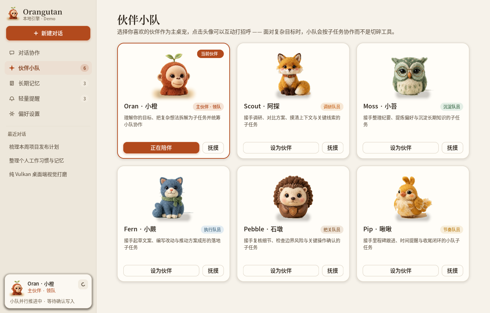
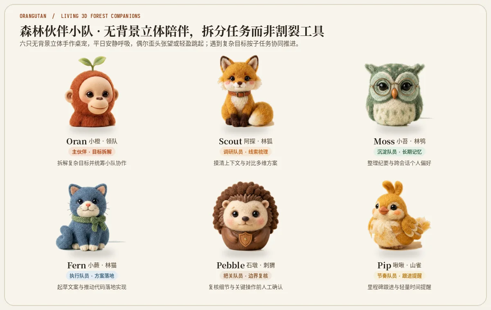

<p align="center">
  
</p>

<p align="center">
  
  
  
  
</p>

<p align="center">
  <a href="#核心能力">核心能力</a> ·
  <a href="#认识森林伙伴小队">伙伴小队</a> ·
  <a href="#快速开始">快速开始</a> ·
  <a href="#接入自己的应用">嵌入运行时</a> ·
  <a href="#系统架构与工作循环">系统架构</a> ·
  <a href="#测试与开发">测试与开发</a>
</p>

# Orangutan

**Orangutan** 是一个用 **C++26** 编写的本地 **Personal Agent** 运行时与 **纯 Vulkan 原生桌面端**。

它坚持三项极简而锋利的设计原则：

1. **精简工具面，Shell 自主组合**：不堆砌几十个碎片化工具包装，内置只保留核心文件读写编辑（`FileRead` / `FileWrite` / `FileEdit`）与受控进程组隔离的 `ShellExec`，让 Agent 通过真实 Shell 自主组合 `ls`、`rg`、`git`、构建与脚本能力，所有外部副作用经权限规则、交互审批与持久化审计把关。
2. **拆分任务，而非割裂工具**：六只可爱的**森林伙伴小队（Forest Companions）**是陪伴你的个人形象与协作团队——面对复杂目标时把**任务**拆解给队员并行推进，而不是把工具切成孤岛。
3. **纯 C++26 + Vulkan 原生桌面端**：无 Electron、无浏览器壳，单 Pass GLSL 450 SDF 管线 + FreeType2 中英文字形图集直连进程内 `oran-bootstrap` 运行时，暖纸张/松木双主题、流畅微动效、本地 SQLite 会话/记忆/提醒零延迟交互。

## 核心能力

| 能力域 | 已实现能力 | 契约文档 |
| --- | --- | --- |
| **纯 Vulkan 原生桌面端 (`orangutan-desktop`)** | `apps/desktop-vk/`：C++26 + Vulkan 1.0 SDF 渲染器 + SDL3（Wayland/X11 + 中文 IME）+ FreeType2 中英文字形图集，内置对话协作、任务拆解板、伙伴小队切换与互动、SQLite 记忆与提醒、暖浅/松木深双主题，支持 `--screenshot` 无头离屏导出。 | [桌面端架构](docs/design-docs/desktop-ui.md) |
| **本地宿主 CLI & 回环桥接 (`orangutan`)** | 默认构建 `orangutan` 二进制：支持 `orangutan chat / ask` 终端交互与 `orangutan serve`（本地回环 HTTP/SSE 桥接、交互审批、SQLite 提醒）；内置 `--demo` 零密钥本地体验。 | [运行状态](docs/STATUS.md) |
| **精简工作区与 Shell 工具** | 内置 `FileRead`、`FileWrite`、`FileEdit` 与进程组隔离、可取消、限流限时的 `ShellExec`（`io::run_subprocess`）；目录浏览、全文搜索、Git 与构建由 Agent 直接通过 Shell 组合。 | [工具运行时](docs/design-docs/tool-runtime.md) · [权限与钩子](docs/design-docs/permissions-and-hooks.md) |
| **模型接入与提示缓存** | 支持 Anthropic Messages 与 OpenAI Responses；流式响应、原生工具调用、重试与回退、用量统计与费用估算。 | [API 可移植性](docs/design-docs/api-portability.md) |
| **会话、长期记忆与提醒** | SQLite 原子提交会话后缀与工作检查点；长对话按预算压缩模型视图而保留原始记录；支持 FTS5 + 中文子串检索的作用域长期记忆，以及持久化个人提醒。 | [记忆系统](docs/design-docs/memory-system.md) · [存储运行时](docs/design-docs/storage-runtime.md) |
| **动态子任务与 Agent 团队** | `AgentRun` 按需创建有界子会话；启用后台服务后支持动态角色团队、依赖审查、队友会话复用与定向消息。 | [Agent 执行](docs/design-docs/agent-platform.md) · [Agent 团队](docs/design-docs/agent-teams.md) |
| **多端渠道与可选 Web 面板** | 可直接部署的 Telegram 私聊宿主（`oran-telegram`）、QQ 扫码绑定（`oran-qq-login`）、飞书协议适配，以及可选浏览器工作台（`apps/desktop`）。 | [消息渠道](docs/design-docs/messaging-channels.md) |

## 纯 Vulkan 原生桌面端实机预览

`orangutan-desktop` 直接使用 **C++26 + Pure Vulkan 1.0 SDF 渲染管线 + FreeType2 中英文字形图集 + 高逼真实物感伙伴纹理图集** 渲染，零浏览器壳、进程内直连 `oran-bootstrap` 与本地 SQLite：

<p align="center">
  
</p>

<p align="center">
  
</p>

## 认识森林伙伴小队

六只**无背景立体手作质感**的森林伙伴（羊毛毡 × 陶瓷木饰 × 玻璃瞳孔高光）：平日里会安静呼吸，偶尔自己歪歪头、张望或轻盈跳起；点击即可抚摸互动或切换常驻桌面，遇到复杂目标时由小队按**子任务**自然分工协同完成：

<p align="center">
  
</p>

| 伙伴 | 团队定位 | 擅长的协作子任务 |
| --- | --- | --- |
| **Oran · 小橙** | 主伙伴 · 领队 | 理解你的意图、把复杂目标拆解成清晰子任务并统筹汇总结论 |
| **Scout · 阿探** | 调研队员 | 接手探索现状、对比方案、摸清上下文与关键线索的子任务 |
| **Moss · 小苔** | 沉淀队员 | 接手整理纪要、提炼个人偏好与沉淀长期知识的子任务 |
| **Fern · 小蕨** | 执行队员 | 接手起草方案、编写改动与推动交付落地的子任务 |
| **Pebble · 石墩** | 把关队员 | 接手复核细节、检查边界风险与关键操作前人工确认的子任务 |
| **Pip · 啾啾** | 节奏队员 | 接手里程碑跟进、轻量时间提醒与跨端收尾闭环的子任务 |

## 快速开始

### 1. 构建 C++26 核心运行时与测试

需要 **Linux**、**GCC 16.1+**、**xmake 3.1.1+**，以及系统 `libcurl` 开发文件与 `pkg-config`（依赖见 [依赖清单](docs/rules/libraries.md)）：

```sh
git clone https://github.com/huxint/orangutan.git
cd orangutan

xmake f -y -m release
xmake build -j4
xmake test -j4
make ci
```

### 2. 启动纯 Vulkan 原生桌面端 (`orangutan-desktop`)

需要系统已安装 `SDL3`、`FreeType2`、`Fontconfig`、`libpng16` 与 Vulkan 驱动（`libvulkan.so.1`）：

```sh
xmake build -j4 orangutan-desktop

# 零密钥本地体验（真实运行 C++26 引擎、ShellExec 与 SQLite 存储）
build/linux/x86_64/release/orangutan-desktop --demo

# 接入真实模型配置 + 暗色松木主题
build/linux/x86_64/release/orangutan-desktop --config config.example.json --theme dark

# 无头离屏 Vulkan 渲染校验与截图
build/linux/x86_64/release/orangutan-desktop --validate --showcase --screenshot /tmp/orangutan-vk.png
```

### 3. 终端交互或启动可选 Web 面板

```sh
# 终端直接对话或单轮提问
build/linux/x86_64/release/orangutan chat --demo
build/linux/x86_64/release/orangutan ask "列出工作区文件" --demo

# 或启动回环桥接服务 + 可选 React/Vite 面板
build/linux/x86_64/release/orangutan serve --demo
npm --prefix apps/desktop ci && npm --prefix apps/desktop run dev
```

### 4. 通过 Telegram 私聊使用

```sh
xmake build -j4 oran-telegram
build/linux/x86_64/release/oran-telegram \
  --config apps/telegram/deepseek.example.json \
  --allow-user "$TELEGRAM_USER_ID" \
  --workspace "$WORKSPACE_DIR" \
  --state "$STATE_DIR"
```

## 接入自己的应用

链接 `oran-bootstrap` 并包含 `<oran/bootstrap.hpp>`，即可在自己的 C++26 应用中组合完整会话：

| 核心接口 | 职责 |
| --- | --- |
| `HttpProviderBackend` | 从显式配置构造模型路由、凭据解析与 HTTP/SSE 传输。 |
| `RuntimeAssembly` | 装配并持有工作区权威、权限审批、钩子总线、审计与 SQLite 存储服务。 |
| `AgentSession` | 载入检查点与记忆索引、驱动模型与工具循环并原子持久化会话。 |
| `BackgroundTasks` | 可选宿主级后台子任务与动态 Agent 团队服务（设置 `enable_teams` 开启）。 |

从 [config.example.json](config.example.json) 开始配置模型路由与权限规则；密钥通过 `api_key_env` 等环境变量引用注入。完整说明见 [运行时装配](docs/design-docs/bootstrap-runtime.md)。

## 系统架构与工作循环

<p align="center">
  
</p>

15 个静态库的分层依赖图由 [ARCHITECTURE.md](docs/ARCHITECTURE.md) 维护并经 CI 自动检查。

<details>
<summary><strong>展开查看：单条消息循环、记忆系统与动态 Agent 团队动图</strong></summary>

### 一次提问如何完成

<p align="center">
  
</p>

### 会话历史与长期记忆

<p align="center">
  
</p>

### 动态 Agent 团队

<p align="center">
  
</p>

</details>

## 测试与开发

```sh
# C++26 核心运行时、15 个测试套件与契约检查
xmake build -j4
xmake test -j4
make ci

# 纯 Vulkan 原生桌面端构建
xmake build -j4 orangutan-desktop

# 可选浏览器工作台验证
npm --prefix apps/desktop run build
npm --prefix apps/desktop test
npm --prefix apps/desktop run format:check
```

开发约定与演进方向见 [AGENTS.md](AGENTS.md)、[STATUS.md](docs/STATUS.md)、[ROADMAP.md](docs/ROADMAP.md) 与 [BUILD_SYSTEM.md](docs/BUILD_SYSTEM.md)。

## License

本仓库目前未提供再分发许可。
