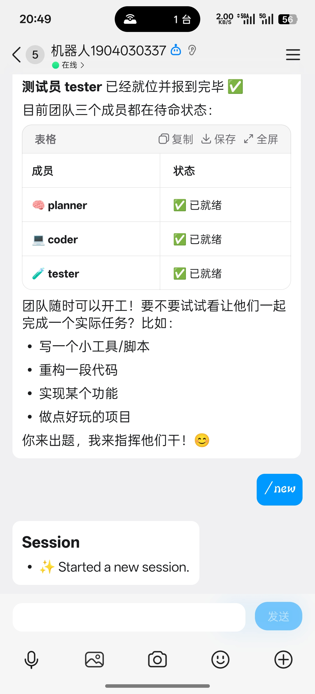
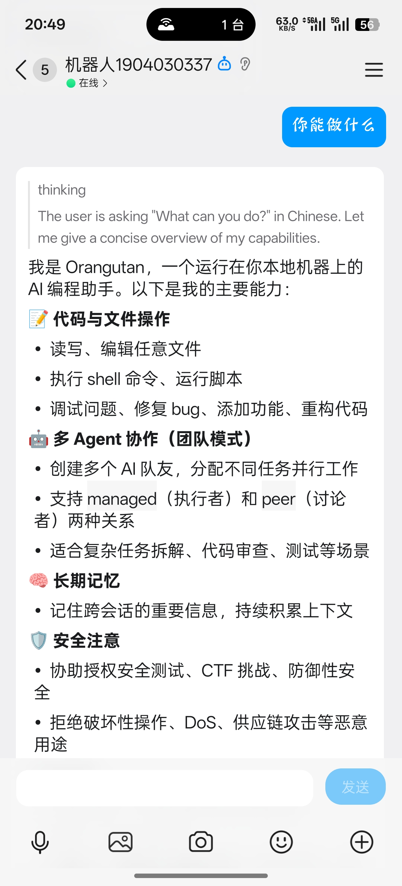

# Orangutan

Orangutan 是一个用 **C++23** 写的本地 AI Agent 运行时，一个二进制就能跑。ReAct 循环、工具调用、权限控制、多模型适配、长期记忆、多 Agent 协作、定时自动化，加上命令行 / Web / QQ 三类入口，都装在同一套运行时里，背后是同一个 Agent。

它要解决的不是「怎么调用某个模型 API」，而是「怎么让一个 Agent 长期、可控地跑在自己的机器上」。

## 它能做什么

- 在命令行、浏览器或 QQ 里都能用，会话可存可恢复；
- 能读写文件、执行命令、跑脚本、接入 MCP 工具；高风险操作先过 allow / deny / ask 权限规则，必要时停下来等人确认；
- 重要的事会沉淀成跨会话的长期记忆，后续对话自动召回；
- 能派出 planner、coder、tester 等多个专职 Agent，通过信箱和团队机制互相配合；干完活不销毁、原地待命，重启后团队还在；
- 支持 cron / interval / once 定时触发，人不在也照常干活，任务状态落 SQLite、重启可恢复。

QQ 是目前接入的外部聊天入口，两个典型场景：

<p align="center">
  
  
</p>

## 快速开始

### 依赖

- C++23 编译器，建议 GCC 14+ 或 Clang 18+
- [xmake](https://xmake.io/)
- SQLite3、libcurl 等其余依赖由 xmake 按 `xmake-requires.lock` 自动拉取

### 构建

```bash
# 配置 release 模式（首次或切换模式时执行）
xmake f -m release

# 只构建主程序
xmake build orangutan
```

### 配置

把样例配置复制到默认路径：

```bash
mkdir -p ~/.orangutan
cp config.example.json ~/.orangutan/config.json
```

按需编辑 `agent`、`profiles`（模型与 API key）、`permissions`、`agents`、`qq_bots` 等字段。API key 不必写死在文件里，可以直接引用环境变量：

```json
"api_key": "${ANTHROPIC_API_KEY}"
```

想把已有明文密钥加密落盘（敏感字段原位改写，并生成备份）：

```bash
xmake run orangutan -- --protect-config-secrets
```

### 启动

```bash
# 交互式 CLI
xmake run orangutan -- --cli

# 单次提问，打印回答后退出
xmake run orangutan -- --cli --message "解释一下这个项目的架构"

# Web UI（默认绑定 127.0.0.1:18080）
xmake run orangutan -- --web

# 启动配置好的 QQ 等 channel adapter
xmake run orangutan -- --channel
```

`--cli`、`--web`、`--channel` 三个入口至少要指定一个；`--message`、`--resume` 等选项需配合 `--cli`。其余选项（模型、agent、权限模式覆盖、event-stream 等）见 `xmake run orangutan -- --help`。

## 设计概览

`main.cpp` 只做一件事：调用 `orangutan::bootstrap::run`。真正的装配集中在 `src/bootstrap/`：解析命令行、加载并解密配置、初始化 SQLite、派生运行时身份，再把 provider、tool、memory、hook、channel、automation、orchestration 组装成一个可运行的 Agent。CLI、Web、QQ、定时触发走的是同一条装配路径，所以新增运行时能力只需接进装配层，入口侧不用改。

<p align="center">
  
</p>

一次提问最多跑 20 轮「想一步 → 用工具 → 再想一步」；每轮重新组装上下文，直到模型不再请求工具、只给出最终回答。

<p align="center">
  
</p>

两个实现上的取舍值得一提：

- **记忆只在循环前召回一次**。长期记忆按运行时作用域隔离，检索只用本次用户输入做一次（最相关 8 条、4 KB 上限），而不是为同一份检索每轮付一次钱；
- **多 Agent「完成不等于销毁」**。常规 subagent 跑完即销毁；这里干完活的 Agent 转入待命、保留上下文，任务以 `<task-notification>` 通知上级，平级队友通过中心信箱横向协作。

模块级的设计细节、数据流与实现讲解见 [docs/architecture.md](docs/architecture.md)；面向开发者的工程约束与开发流程见 [CLAUDE.md](CLAUDE.md)。

## 测试

```bash
xmake test                     # 全量测试
xmake run test-agent           # 只跑一个模块桶（tests/ 下每个目录对应一个 test-* 目标）
xmake run test-agent "[tag]"   # 按 Catch2 标签过滤
```

代码质量由 clang-format、clang-tidy 与 clangd 把关，pre-commit 钩子会自动格式化暂存的 C/C++ 文件。

## License

Proprietary. All rights reserved.
