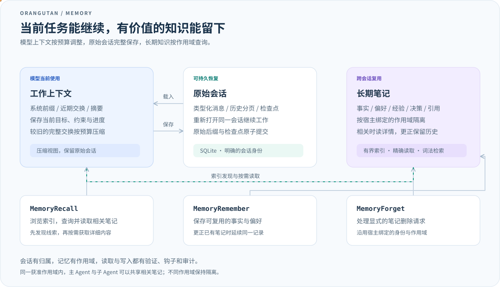

# 架构与实现细节

Orangutan 的整体概览、快速开始与测试方式见 [README](../README.md)。本文面向想深入了解模块划分、数据流和关键实现取舍的读者；给 Claude Code / 贡献者的工程约束与开发流程见 [CLAUDE.md](../CLAUDE.md)。

## 功能总览

| 能力 | 实现重点 | 代码入口 |
|------|----------|----------|
| ReAct Agent Loop | 「模型响应 → 工具调用 → 工具结果 → 继续推理」的多轮循环，支持流式输出、thinking、重复调用检测、历史压缩和记忆蒸馏。 | `src/agent/agent-loop.cpp` |
| 多模型 Provider | 统一 `ProviderRequest` / `ProviderResult`，把 Anthropic Messages、OpenAI Chat Completions、OpenAI Responses 收进协议适配层，执行层负责重试、兜底切换和用量统计。 | `src/providers/` |
| 工具注册与分发 | `ToolRegistry` 统管工具定义、权限检查、执行函数、富文本结果和 deferred tool discovery，内置文件、shell、MCP、memory、orchestration、automation、skill、script 等工具。 | `src/tools/` |
| 权限系统 | allow / deny / ask 规则、命令安全检查、人工审批提示和签名 replay，不让 Agent 直接执行危险操作。 | `src/permissions/` |
| 会话与长期记忆 | SQLite 持久化会话历史与记忆，支持运行时作用域、检索、衰减 / 保留策略，以及可选的 `MEMORY.md` 镜像。 | `src/storage/`, `src/memory/` |
| 多 Agent 编排 | `OrchestrationManager` 负责队友生命周期、并发上限、停止令牌、通知、信箱消息和团队关系。 | `src/orchestration/` |
| 自动化任务 | cron / interval / once 触发器，任务状态落 SQLite，每次触发都新建一个 Agent 执行上下文。 | `src/automation/`, `src/heartbeat/` |
| 多入口运行 | CLI REPL、单次提问、HTTP Web UI + SSE、QQ channel 共用同一套运行时装配逻辑。 | `src/cli/`, `src/web/`, `src/channel/` |
| 配置与密钥保护 | JSON 配置覆盖 profile / agent / permission / channel，API key 等敏感字段可加密落盘。 | `src/config/` |

## 核心实现细节

### 1. Agent Loop：一次任务的完整生命周期

`AgentLoop` 是整个项目的核心。它维护对话历史，每轮调用 provider，解析模型返回的 `Content`，把 `ToolUse` 派发给工具系统，再把 `ToolResult` 作为 user message 写回历史。

几个关键点：

- `MAX_ITERATIONS = 20` 限制单次任务的推理 / 工具轮数，避免无限运行；
- 回答撞到 `max_tokens` 上限时自动续写，最多续 3 次；
- 同一个工具重复调用先警告，再重复就中止，避免模型原地打转；
- 每轮开头先收队友消息、检查停止令牌、刷新可用技能，运行中新发现的能力能进入后续提示词；
- 记忆召回在进入循环之前渲染一次，不在每轮重复检索。

<p align="center">
  
</p>

相关文件：`src/agent/agent-loop.cpp`, `src/agent/tool-executor.cpp`, `src/prompt/`

### 2. Provider：把模型差异关进协议适配层

不同厂商 API 在 tool use、streaming、thinking、stop reason 上的差异很大。Orangutan 用统一的 `ProviderRequest`、`ProviderResult`、`ProviderEvent` 把上层 Agent 和厂商协议隔开，上层只看这三种类型。

Provider 分三层：

- `transport/`：libcurl HTTP、SSE 解析、curl handle / header 的 RAII 封装；
- `protocols/`：Anthropic Messages、OpenAI Chat Completions、OpenAI Responses 三套协议适配；
- `execution/`：重试、fallback 模型切换、active target 跟踪、用量统计聚合。

一条路由就是「主模型 + 一串兜底模型」，切换发生在执行层，Agent 侧无感。

相关文件：`src/providers/provider.hpp`, `src/providers/protocols/`, `src/providers/execution/`

### 3. Tool Registry：工具能力可注册、可审计、可控制

工具不是散落在 Agent 里的 if/else，而是统一注册进 `ToolRegistry`。每个工具携带：

- 给模型看的 `ToolDef` schema；
- 权限检查函数；
- 纯文本或富文本执行结果；
- read-only / deferred 等元信息。

文件操作、shell、MCP、memory、automation、orchestration、skill 因此共用同一套分发与权限逻辑。新增一个工具只需要注册定义、权限和执行函数，不用碰 Agent loop。

相关文件：`src/tools/registry/tool-registry.hpp`, `src/tools/register.cpp`, `src/tools/*/`

### 4. 会话与记忆：三层状态，两条通道

状态分三层，寿命依次变长：

- **工作记忆**：这一轮对话的全部内容，只活在进程里；攒得太长先压缩成摘要再接着跑；
- **会话记忆**：一次会话的完整历史，逐条写进 SQLite，按运行时身份归属，关掉再打开能从上次那句接着说；
- **长期记忆**：跨会话常驻的事实，按 key 覆盖写入，分 user / feedback / project / reference 四类语义，每个运行时身份一套作用域。

两条通道连接它们：

- **召回**：只拿用户这一次输入去检索，取最相关的 8 条，整块封顶 4 KB，超出直接截断，然后拼进系统提示；
- **蒸馏**：会话落幕时把整段对话（过长则掐头留尾）压成最多 8 条长期记忆，按 key 覆盖写回。

关键的取舍在召回的时机：检索只在进入循环之前做一次。循环最多跑 20 轮，若每轮都查一遍，就是为同一份检索付 20 次钱。

<p align="center">
  
</p>

相关文件：`src/agent/session-memory.cpp`, `src/memory/`, `src/storage/`

### 5. 多 Agent 编排：完成不等于消失

常见的 subagent 是一次性的：主 Agent 拆出子任务、派生子 Agent，子 Agent 跑完交回一段文字，然后连同自己的上下文一起销毁。子 Agent 之间不能直接说话，所有信息经主 Agent 中转。

<p align="center">
  
</p>

这套模式对短平快、一次交付的子任务够用。问题出在任务需要多轮追问、需要几个角色互相配合的时候：同一段背景要反复重讲，子 Agent 没有回路只能带着猜测把话说完，主 Agent 成了唯一的中转瓶颈，而所有回执又都堆回它自己的上下文。

Orangutan 换了个结构：一个信箱，两种关系。

<p align="center">
  
</p>

- **上下级（managed）**：只有主 Agent 拿得到 `agent_spawn` / `agent_stop` / `team_*`；派活、叫停走编排通道直连，不经信箱，任务完成以 `<task-notification>` 落进主 Agent 的对话。
- **平级（peer）**：在中心信箱里横着对话，讨论、质疑、对齐节奏，不必绕回主 Agent；除非任务明确要求，否则不动文件。
- **信箱**：`AgentMailbox` 落 SQLite，支持点对点、按名字和 `to:"*"` 广播。队友手里只有 `agent_send_message`，层级到此为止。
- **完成不销毁**：干完转入待命，会话与记忆作用域原地保留，也不占并发槽位；下一条消息把它原地唤醒，上下文接着用。
- **并发与恢复**：`max_concurrent_agents` 控制并发上限；run、信箱、团队关系都在 SQLite，重启后队还是那支队。

相关文件：`src/orchestration/`, `src/tools/orchestration/`, `src/bootstrap/agent-loop-teammate.*`

### 6. 自动化：让 Agent 主动运行

自动化模块把「什么时候触发」和「触发后怎么跑 Agent」拆开：

- `Automation` 表达任务定义；
- 触发器支持 cron、interval、once；
- repository 用 SQLite 保存任务、下次触发时间、运行记录和状态；
- 到期后 runtime 通过 executor callback 现场组装一个全新的 Agent 运行时；
- category 机制允许 heartbeat 这类任务自定义结果处理。

相关文件：`src/automation/`, `src/bootstrap/automation-executor.*`, `src/heartbeat/`

## 技术难点与工程取舍

| 难点 | 处理方式 |
|------|----------|
| 各家 LLM API 差异大 | 上层只认统一的 provider 类型，厂商差异全部封在协议适配层。 |
| 工具调用有安全风险 | 执行前过权限规则和 safety checks，高风险命令进入 ask / deny 流程。 |
| 多入口共享运行逻辑 | CLI、Web、QQ、automation 都走 bootstrap 的运行时装配，不复制 Agent 构建代码。 |
| 多 Agent 状态隔离 | 用运行时身份、session store、记忆作用域、信箱 / 团队存储区分不同运行实例。 |
| 长会话上下文膨胀 | 支持历史压缩和会话记忆蒸馏，召回结果按用户输入预渲染，避免逐轮重复检索。 |
| 定时任务可靠性 | 任务定义和调度状态落 SQLite，重启后可恢复；触发计算与执行回调解耦。 |
| C++ 工程复杂度 | xmake 管理构建，Catch2 按目录拆测试桶，核心边界以小模块组织，可恢复错误一律用 `std::expected` 表达。 |

## 代码导览

```text
src/
├── bootstrap/      # 程序入口和运行时装配
├── agent/          # ReAct AgentLoop、工具执行、历史压缩、记忆蒸馏
├── providers/      # LLM transport / protocol / execution
├── tools/          # 工具注册、文件/shell/MCP/自动化/编排等工具
├── permissions/    # 权限规则、审批签名、安全检查
├── orchestration/  # 多 Agent 生命周期、mailbox、team
├── automation/     # cron/interval/once 自动化任务
├── heartbeat/      # heartbeat 类自动化任务的自定义运行器
├── memory/         # 长期记忆和 runtime memory scope
├── storage/        # SQLite session store 和通用 SQLite 封装
├── config/         # JSON 配置、环境变量、密钥保护
├── process/        # 子进程与 fd 工具（shell 工具的执行底座）
├── types/          # 跨模块共享的 message / content / tool-def 等类型
├── cli/            # REPL、single-shot、slash command
├── web/            # HTTP routes、SSE、Web UI 后端
├── channel/        # QQ 等外部聊天入口
├── prompt/         # 系统提示词组装与预渲染
├── skills/         # skill loader
├── hooks/          # tool/message 生命周期 hook
└── utils/          # expected、sender、task pool、字符串/时间等工具
```
